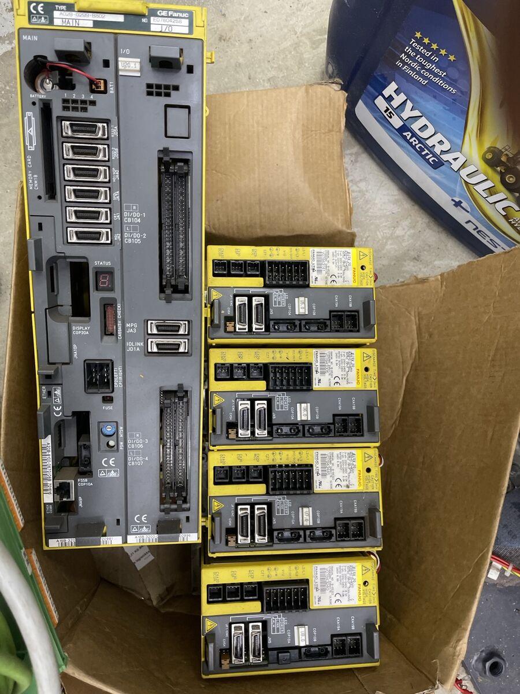
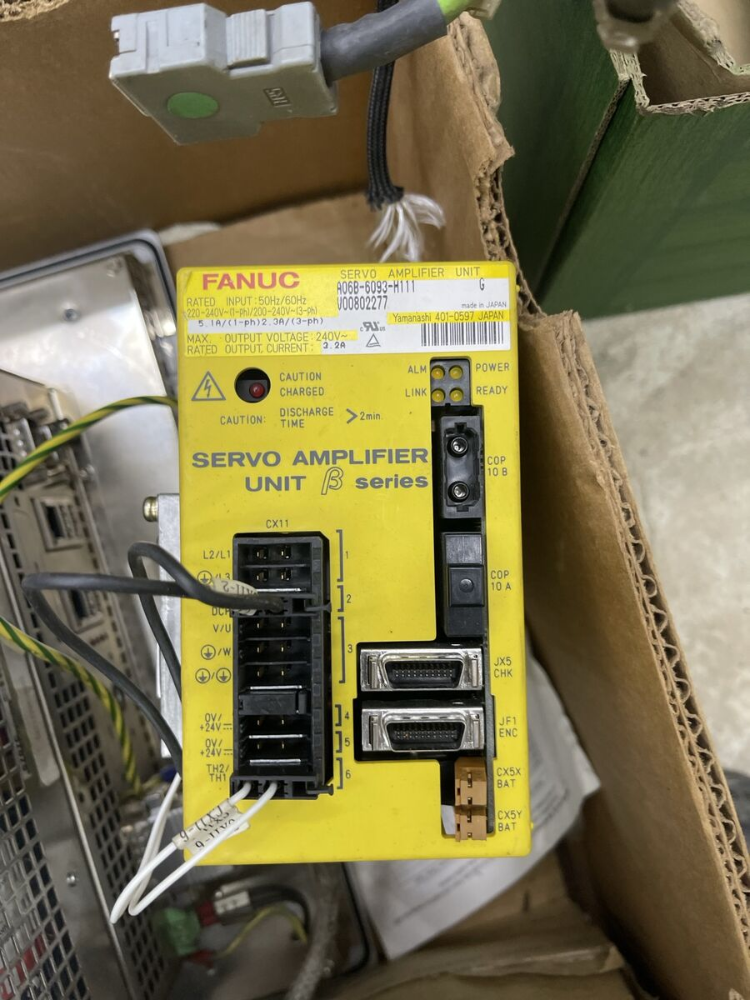

# The FANUC control and amplifiers

| unit | label | notes |
|---|---|---|
| CNC control unit | GE Fanuc, type A02B-0289-B802, MAIN + I/O | the Series 0i family ✱. Connectors: FSSB (COP10A), RS-232 (JD5A, JD5B), spindle (JA7A), MPG (JA3), I/O Link (JD1A), DI/DO (CB104–CB107), display (COP20A), Ethernet, memory card |
| 4 × servo amplifier | βiSV 20 | FSSB (COP10A/B), encoder JF1, battery CX5X, 24 V CXA19A/B, power CZ7 ✱ |
| 1 × servo amplifier | β series, A06B-6093-H111 | input 220–240 V 1-ph 5.1 A / 200–240 V 3-ph 2.3 A, max. output 240 V, rated output 3.2 A; FSSB (COP10A/B), JF1 ENC, battery CX5X/CX5Y |

## Why the motors run on stmbl instead

The amplifiers take their commands only over **FSSB**, FANUC's closed
fibre-optic servo bus, from a FANUC CNC. LinuxCNC can't drive them. The
βiSV 20 would suit the βiS motors (and the β amplifier the α2), but only
under this CNC.

## Using them as a reference system

The CNC, one βiSV 20 and one βiS motor, wired as FANUC intends, talk to a
βiA128 the way the encoder expects. Recording that link gives the real
request and reply frames, including any start-up exchange.

1. **Power:** the 24 V control supply only, no 3-phase mains. The motor
   can't move. The amplifier will likely show alarms, which doesn't matter.
   It should still poll the encoder once the CNC has set up FSSB ✱. If it
   doesn't, mains is needed: then the motor must be clamped down and the
   usual high-voltage precautions apply.
2. **Tap** the REQ and RD pairs between amplifier and encoder, passively
   (a spare cable opened into a T at the motor end is easiest). Nothing in
   series with the signals.
3. **Record** with a logic analyzer (24 MHz is enough for 1.024 Mbit/s,
   e.g. sigrok/PulseView), through an RS-485 receiver module on each pair.
4. **Captures:** once with the shaft still, once turning slowly by hand in
   one direction, and the power-up sequence. Save them for the decoder and
   its host tests (see [encoders.md](encoders.md)).

Do the same with the α2/3000 on the β amplifier if it can be set up: an
αA64 capture from FANUC's side checks `encf`'s request against the
original.
