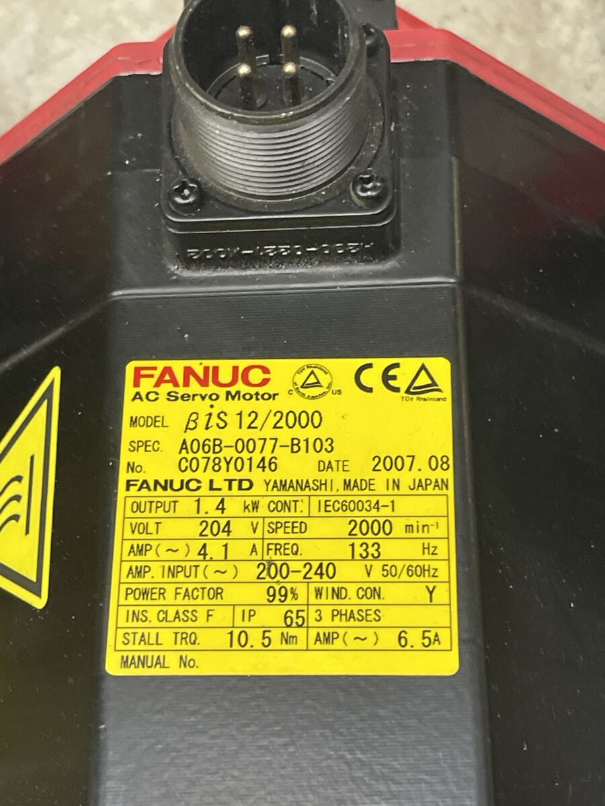
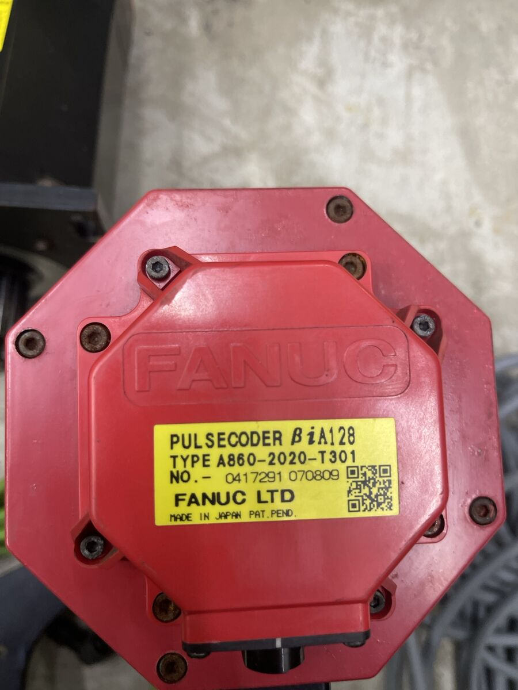
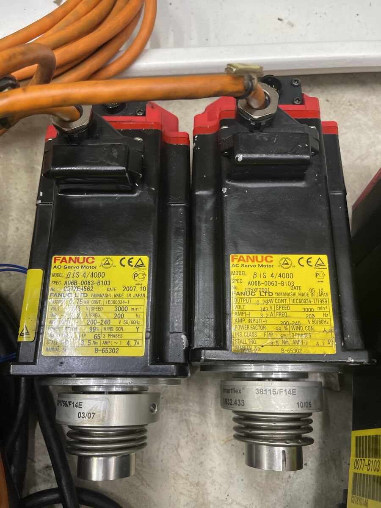
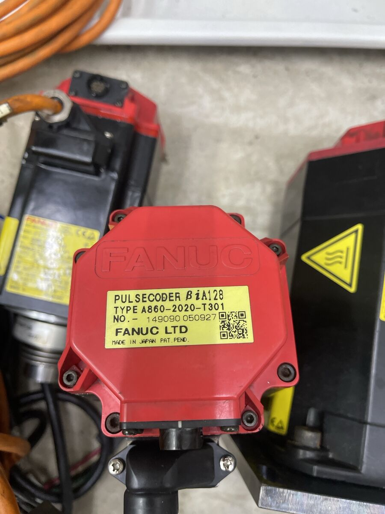
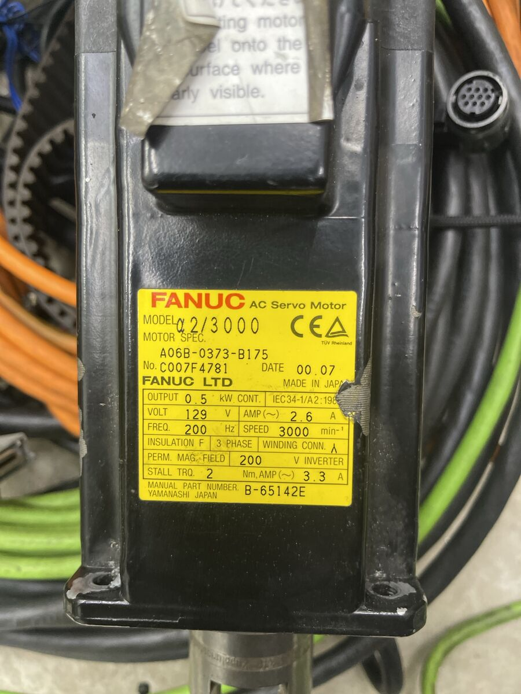
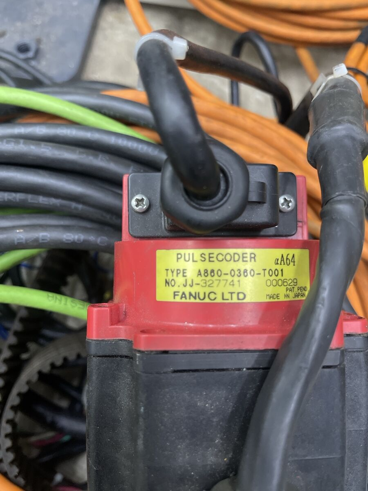

# FANUC motors

Nameplate values as read from the photos. Derived values are calculated
from them:
- **pole pairs** = f × 60 / n (rated frequency, rated speed);
- **torque constant** ≈ stall torque / stall current (Nm per A rms);
- **rated torque** = P / ω at rated speed.

The motor parameters stmbl uses (`conf0.r`, `conf0.l`, `conf0.j`, the
torque constant) come from autotune on the bench, not from these numbers.

## βiS 12/2000 (×2)

| | |
|---|---|
| spec | A06B-0077-B103 |
| serial, date | C078Y0146, 2007.08 (one of the two) |
| output | 1.4 kW continuous (IEC 60034-1) |
| voltage, current | 204 V, 4.1 A at rated speed |
| speed, frequency | 2000 min⁻¹, 133 Hz |
| amplifier input | 200–240 V 50/60 Hz |
| winding | Y, 3 phases, insulation class F, IP65 |
| stall | 10.5 Nm, 6.5 A |
| power connector | 4 pins: U, V, W, PE ✱ |
| encoder | βiA128, A860-2020-T301 (No. 0417291, 070809) |

Derived: 4 pole pairs (133 × 60 / 2000 = 3.99), torque constant ≈
1.6 Nm/A, rated torque ≈ 6.7 Nm at 2000 min⁻¹.

## βiS 4/4000 (×2)

| | |
|---|---|
| spec | A06B-0063-B103 |
| serials, dates | C07XE4562, 2007.10; C05XF2001, 2005.10 |
| output | 0.75 kW continuous |
| voltage, current | 143 V, 3.2 A at rated speed |
| speed, frequency | 3000 min⁻¹, 200 Hz (the model name says 4000: the top speed ✱) |
| amplifier input | 200–240 V 50/60 Hz |
| winding | Y, 3 phases, class F, IP65 |
| stall | 3.5 Nm, 4.7 A |
| manual | B-65302 |
| encoder | βiA128, A860-2020-T301 (No. 149090, 050927 on one) |
| on the shaft | Mayr smartflex bellows couplings (38.115/F14E) |

Derived: 4 pole pairs (200 × 60 / 3000), torque constant ≈ 0.75 Nm/A,
rated torque ≈ 2.4 Nm at 3000 min⁻¹. 143 V at 3000 min⁻¹ leaves a lot of
headroom on a 325 V bus for 4000 min⁻¹.

## α2/3000 (×1)

| | |
|---|---|
| spec | A06B-0373-B175 |
| serial, date | C007F4781, 2000.07 |
| output | 0.5 kW continuous (IEC 34-1) |
| voltage, current | 129 V, 2.6 A at rated speed |
| speed, frequency | 3000 min⁻¹, 200 Hz |
| for | 200 V inverter |
| winding | Y, 3 phases, class F |
| stall | 2 Nm, 3.3 A |
| manual | B-65142E |
| encoder | αA64, A860-0360-T001 (No. JJ-327741, 000629) |

Derived: 4 pole pairs, torque constant ≈ 0.6 Nm/A, rated torque ≈
1.6 Nm at 3000 min⁻¹.

## For stmbl

| | βiS 12/2000 | βiS 4/4000 | α2/3000 |
|---|---|---|---|
| `conf0.polecount` | 4 | 4 | 4 |
| encoder comp | βiA128: to be tested | βiA128: to be tested | `encf` (template `fanuc_fb0`) |
| `conf0.max_vel` (rad/s, start) | 209 (2000 min⁻¹) | 314 (3000 min⁻¹) | 314 (3000 min⁻¹) |
| current to start with (rms) | rated 4.1 A, stall 6.5 A | rated 3.2 A, stall 4.7 A | rated 2.6 A, stall 3.3 A |
| `conf0.r`, `l`, `j` | autotune | autotune | autotune |

- **Peak current:** the labels give no peak current. Start `conf0.max_ac_cur`
  near the stall current and raise it only with the motor's peak rating
  from the manual ✱ (B-65302 for βiS, B-65142E for α).
- **Temperature sensor:** FANUC motors report temperature through the
  encoder (in the serial frame), not on separate wires ✱. Until that is
  decoded, protect the motors with the drive's I²t and conservative current.
- **Brakes:** none seen. Don't use them on an unbalanced vertical axis.
- **Existing confs:** `conf/fanuc_a06b.txt`, `conf/fanuc_a6-2000.txt` and
  `conf/fanuc_b05-6000.txt` are for other α motors; they are starting
  points, not settings for these.
