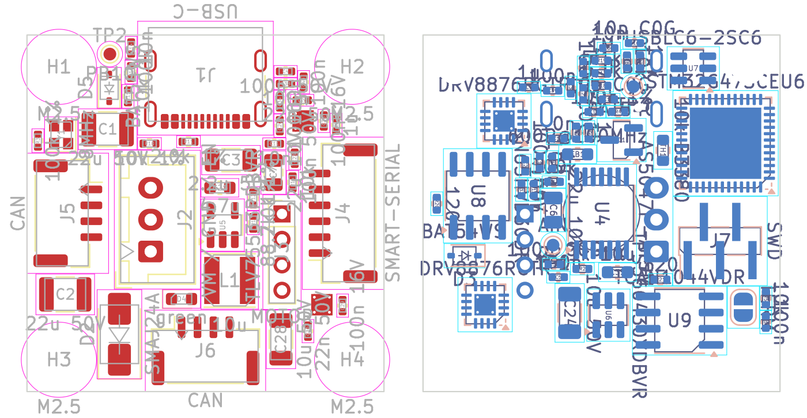

# brdstepper KiCad project

The closed-loop NEMA11 stepper drive of [docs/brdstepper_hw.md](../../docs/brdstepper_hw.md)
as a KiCad 7 project: schematic, a placed (not routed) 28 × 28 mm board, a BOM.

**State:**
- **Schematic:** complete. Every part and connection of the document is in
  it, and checked (below).
- **Board:**
  - Outline, the M2.5 holes on the motor's 23 mm square, four layers, and a
    GND plane on In1.Cu (not filled: press B).
  - Every footprint placed, with its nets. U4 (the encoder) is on the
    bottom, on the shaft axis.
  - **Not routed.** The placement is a starting point for the layout
    (see *Placement*).
- **Not checked against datasheets:** every part marked ✱ (in its *Note*
  field and the BOM). Above all:
  - **AS5047P pinout:** taken from KiCad's AS5047D (same family and
    package).
  - **TPS560430:** the inductor value (10 µH) and the compensation.
  - **Transceivers:** the SN65HVD30 and TCAN1044V are drawn with the
    MAX3490 and TJA1042T-3 symbols (same pinouts).
  - **Crystal load capacitors.**
  - **TVS and connector current ratings.**

## Files

| file | what |
|---|---|
| `brdstepper.kicad_pro`, `brdstepper.kicad_sch` | the project; the schematic is one A2 sheet with a framed section each for power, MCU, bridges, encoder and interfaces |
| `brdstepper.kicad_sym`, `sym-lib-table` | the project's own symbols: DRV8876RGT, TPS560430, AS5047P |
| `brdstepper.kicad_pcb` | the board |
| `brdstepper-bom.csv` | parts by value and footprint, with variant (A smart-serial, B CAN) and notes |
| `doc/` | the schematic as PDF, the placement render |
| `gen/` | what makes all of the above |

## Generated: edit `gen/parts.py`

Every part, value, footprint and pin connection is in `gen/parts.py`, as
transcribed from the document (section numbers in its comments). `make`
regenerates everything:

| step | does |
|---|---|
| `gen/gen.py` | symbols, project, the schematic (one sheet, the sections packed onto the smallest paper that holds them) |
| `gen/check.py` | exports the netlist with kicad-cli and checks it against `parts.py` (see *Checks*) |
| `gen/pcb.py` | the board: outline, holes, footprints, nets, placement, plane |
| `gen/drc.py` | KiCad's DRC |
| `gen/bom.py` | the BOM |

`make pcb` places everything again, so hand edits to the board are lost.
Once layout starts by hand, change the schematic in KiCad (or `parts.py` +
`make sch`) and use *Update PCB from Schematic*. The footprints carry
their symbols' links.

**Schematic style:**
- Pins are joined by net name (net labels), not by drawn wires: each
  section reads as a list of parts with their nets.
- Unused pins carry no-connect flags.
- IMODE of the DRV8876s is left open on purpose (§4.2).

## Checks

KiCad 7's `kicad-cli` has neither ERC nor DRC, so:

**`gen/check.py`** reads the netlist KiCad makes of the schematic and
checks:
- every net has exactly the pins `parts.py` gives it, and no other net
  exists;
- every other pin is unconnected (a no-connect flag);
- no net has a single pin;
- ERC's pin-type rules: power inputs are driven (a power output or a
  PWR_FLAG); no two outputs and no two power outputs share a net.

Result: 94 parts, 67 nets, no errors.

**`gen/drc.py`** runs KiCad's DRC through pcbnew. Result:
- no clearance, courtyard, edge or hole violations;
- only the unrouted connections;
- footprint-library warnings, which appear only where KiCad's footprint
  libraries aren't configured, as in a headless install.

## Placement

28 × 28 mm holds one PCB for both variants only just, so the generator
places by rule and reports anything that finds no room:

**Edges:**
- J1 USB-C north;
- J4 smart-serial east;
- J5 CAN west;
- J6 CAN south.

**Encoder and supply:**
- U4 on the bottom, on the shaft axis.
- J2, the supply (VM, GND, EN), sits on top beside the shaft. Its pins
  pass next to U4. It carries DC, so its VM and GND pins side by side
  largely cancel at the sensor. ✱ Check on the bench.

**Parts kept off the centre:** the parts carrying the switched coil
current stay out of a square around the shaft (§8):
- the DRV8876s and their VM capacitors: ±5.5 mm;
- the motor pads: ±4 mm;
- the buck and its input parts: ±3 mm.

**Parts kept on top:** L1, C1/C2, D2, J2 and J3 are too tall for the
bottom, which faces the motor a few mm away.

**Through-hole and thermal-via parts:** they reserve their pins on the
other side. The ThermalVias QFN footprints carry a copper pad on the far
side too, so U2 and U3 take room on both sides.

**Choices the document leaves open, made here for room:**

| part | document | here | why |
|---|---|---|---|
| J3 motor | JST-PH 4, or solder pads | 4 pads at 2.0 mm (fit a header or solder the motor leads) | a PH 4 doesn't fit next to the four edge connectors |
| J7 SWD | TC2030, or 1.27 mm 5-pin | 1.27 mm 5-pin, SMD, on the bottom (VCC SWDIO NRST SWCLK GND) | the TC2030's guide holes found no free spot on both sides |
| U1 footprint | exposed pad with vias | plain QFN-48 footprint | the ThermalVias version's bottom pad has no room; add the GND vias in layout |

**Layout to do:**
- **Fan-out:** U1's exposed-pad vias.
- **Power loops:** each DRV8876's VM capacitors right at its pins (§8).
- **IPROPI:** route as analog, away from OUTx.
- **USB:** D+/D− as a 90 Ω pair.
- **Encoder:** no coil-current copper under U4.
- **Planes:** the In2.Cu power pour.
- **Test pads:** the list in §8.
