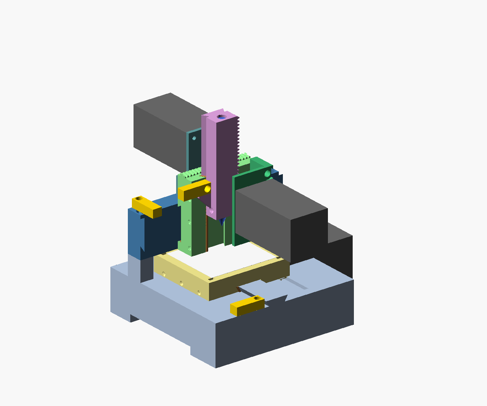

# The stmbl test stand

A small 3-axis machine to go with a controller kit. Everything is printed except the three NEMA 23
servos and three micro switches. It shows that the kit works: the drives come up, the machine
homes on its switches, and it draws a picture on paper with a pen (`demo.ngc`). The servos can
then be tuned on a real, if light, mechanism.



| | |
|---|---|
| travel | X ±35, Y ±40, Z 0 … −40 mm (the pen touches the paper at −40) |
| layout | fixed bridge, the table moves in Y (the CN 720's; millweb type `bridge`) |
| slides | printed 60° dovetails with a gib strip and three gib screws each |
| drive | printed rack and pinion, module 1.5, 20 teeth: **94.25 mm a motor turn** |
| switches | X at −35 (the carriage), Y at +40 (the table's front edge), Z at 0 (a tab on the slide) |
| size | 212 × 210 mm base, about 270 mm high; the motors stick out at the right, the back and the front |
| prints | 21 different parts, 54 in all, every one within 215 × 215 mm |

## Printing

PETG (or PLA), 0.2 mm layers, 4 walls. `make` writes the STLs into `stl/` (not kept in git),
each already lying the way it prints.

| part | qty | notes |
|---|---|---|
| `base` | 1 | solid on purpose (weight): 15 % infill, about 0.7 kg; the Y rail, the bridge's columns and the Y motor's plate are part of it |
| `beam` | 1 | on its back, the X rail up |
| `table` | 1 | top down; the Y rack under it |
| `x_carriage` | 1 | front down; the X rack on its top edge |
| `z_slide` | 1 | standing; 40 % infill |
| `x_motor_bracket`, `z_motor_bracket` | 1 each | the plate down |
| `gib_x`, `gib_y`, `gib_z` | 1 each | lying |
| `pinion` | 3 | 100 % infill |
| `snap_pin` | 12 | lying; four hold each motor (through its flange and the plate) |
| `switch_holder` | 3 | |
| `bolt_45` (P8x2) | 4 | 2 beam on columns, 2 Z motor bracket |
| `bolt_25` (P8x2) | 5 | 2 X motor bracket on the beam, 3 switch holders |
| `gib_screw_50` / `_25` / `_14` (P6x1.5) | 3 each | the table's, the Z slide's, the X carriage's gib |
| `set_screw` (P8x2) | 3 | a pinion's grub screw onto the shaft's flat |
| `thumb_screw` | 1 | holds the pen |
| `paper_clip` | 4 | |

The threads are printed (a round single-start profile, `thread()` in the SCAD). Run each bolt into
its hole once before assembly, slowly: that cuts the hole to size.

## Bought

- 3 × NEMA 23 servo (57 mm flange, 47.14 mm hole square, 38.1 mm pilot, 8 mm D-shaft at least
  21 mm long; `shaft_d`, `shaft_len`, `nema_flange_t` at the top of the SCAD for others).
- 3 × micro switch, 20 × 10 × 6.4 mm with a lever (SS-5GL, KW12, V-156 …).
- A pen or a fine marker, 11–12 mm thick; paper (100 × 90 mm).

## Assembly

1. **Table on the base.** Slide the table onto the Y rail from the front, then put `gib_y` into the
   gap on the rail's left flank. Run the three long gib screws in from the table's left side until
   the table slides without play, then back them off a little. Put a drop of oil or PTFE dry lube
   on the rails.
2. **Beam on the columns.** The pins on the columns locate it; then one `bolt_45` into each
   column.
3. **X carriage on the beam's rail** from one end, with `gib_x` on the lower flank and its screws
   from below. **Z slide into the carriage's front groove** from below, with `gib_z` on the left
   flank and its screws from the left.
4. **Motors.** Push each pinion onto its shaft with the grub screw over the flat. Hold the motor
   to its plate with four snap pins, pushed from the motor's side until they click behind the
   plate. Then bolt the X motor bracket onto the beam and the Z motor bracket onto the carriage's
   front. Mesh each pinion with its rack: the brackets' holes leave no adjustment, so the mesh is
   right as printed. A tight mesh means the print is oversize: sand the rack's teeth.
5. **Switches.** Press each into its holder, the lever out of the face, wires through the slot.
   Bolt the holders on: Y on the base's front (the table's front edge trips it), X on the beam's
   top at the left (the carriage's left side), Z on the carriage's front at the left (the slide's
   tab).
6. **Pen** into the slide's bore from the top, with its tip 15 mm below the slide; tighten the
   thumb screw from the left.

## Wiring and configuration

- **Switches:** wire them normally closed (COM and NC) to inputs, so that a broken wire looks
  like a pressed switch.
- **millweb:** `webui/mill/machines/teststand/machine.json` is the machine. Its pins assume a
  Mesa 7i96s (smart-serial port 0, channels 0–2 for X, Y, Z; E-STOP on input 0, the switches on
  inputs 2–4); change `board` and the pins for your controller in the Configure page (Pins…
  lists them).
  - `mech.lead` 94.24778 with ratio 1 on each joint: LinuxCNC works in mm, and the drives get
    motor radians (scale comps, 15 rad/mm).
  - If an axis runs the wrong way, tick *Motor turns the other way* on its joint.
  - If the drawing comes out mirrored in Y, the Y joint wants that too: the table moves against
    Y.
- **Drive limits:** a 1 kW servo breaks printed teeth easily. Before the first move, set the
  drives' limits low and raise them later:
  - `conf0.max_ac_cur` about 1–2 A: a few tens of newtons at the rack;
  - `conf0.max_vel` 15 rad/s: 140 mm/s, a little above the axes' 100 mm/s;
  - a small following error (2 mm in machine.json).

  Back up each drive's config first (`servoterm-cli --dump`).
- **First run:**
  1. Home: Z first, then X and Y, each onto its switch and back off.
  2. Clip a sheet onto the table.
  3. Load `demo.ngc`. It draws about 0.94 m in about a minute: a border, three circles both ways
     round at three feeds, a diamond, a spiral and STMBL.

## The model

`teststand.scad` is parametric:
- **the motor:** flange, holes, pilot, shaft;
- **the gearing:** module, teeth, backlash;
- **the fits:** slide clearance, bolt clearance, gib;
- **the switch's size.**

`part="assembly"` with `X`, `Y`, `Z` shows the machine at a position.

```
make            # stl/ (every part, as printed) and img/ (the pictures)
make check      # the moving parts against the rest at the travel's corners (check.py, ~2 min)
python3 bedfit.py   # each STL lies on the bed and fits it
python3 demo.py demo.ngc
```

`check.py` intersects each moving group (table; X carriage with its brackets, motor and switch;
Z slide) with the fixed parts and with the others, at all eight corners of the travel and in the
middle, and checks the parts within a group against each other. It reports anything with volume:
71 checks, none touching. A move past the travel (X −60, Z −60) does show up, so the check is
live.

The rack and pinion were checked separately: their 2D profiles over a full tooth pitch, the rack
following the pinion, never overlap.

## Not tested yet

The stand has not been printed or run. Expect the fits to need a print or two to settle:
- `c` for the slides;
- `fit` for the threads;
- `backlash` for the gears.
