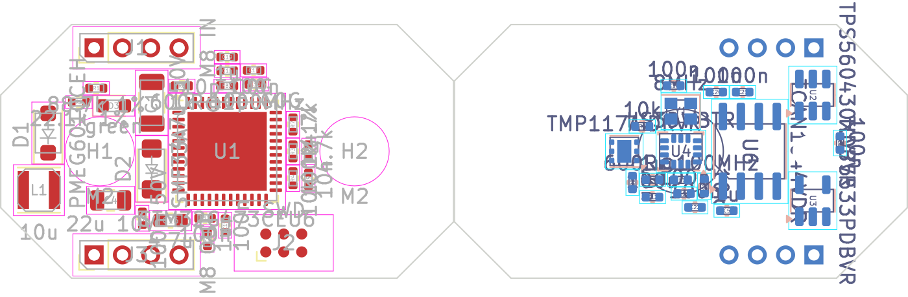

# vibsensor KiCad project

The vibration and temperature sensor of [docs/vibsensor.md](../../docs/vibsensor.md),
for the firmware in [vibsensor/](../../vibsensor/README.md): a KiCad 7
project with the schematic, a placed (not routed) 32 × 18 mm board shaped to
the enclosure, and a BOM. The enclosure concept is in [enclosure/](enclosure/README.md).

**State:**
- **Schematic:** complete, one sheet, checked against the part list
  (`make sch`: 50 parts, 33 nets).
- **Board:**
  - 32 × 18 mm, chamfered to the enclosure "Shard", four layers, a GND plane
    on In1.Cu (not filled: press B in the editor).
  - Every footprint placed with its nets; DRC clean but for the unrouted
    connections.
  - **Not routed:** the placement is a starting point for the layout.
- **To check against datasheets** (✱ in each part's *Note* and the BOM):
  - the IIS3DWB's pinout and decoupling (DS12569);
  - the TMP117's pinout and exposed pad;
  - the TCAN1044V, drawn with the TJA1042T-3 symbol (same pinout);
  - the buck converter's inductor;
  - the crystal's load capacitors;
  - the M8 sockets' pin order (no CiA standard for M8 4-pin).

## The circuit

| section | parts |
|---|---|
| supply | J1 (IN) and J3 (OUT), the two M8 sockets' leads, wired 1:1 (1 V+, 2 CAN_H, 3 GND, 4 CAN_L), so supply and bus pass through to the next sensor; D1 reverse polarity; D2 TVS; U2 TPS560430 buck to 5 V (the transceiver); U3 TLV75533 to 3.3 V; ferrite-filtered VDDA and the accelerometer's own 3V3_ACC; R3 / R4, the bus voltage to PA0 |
| MCU | U1 STM32G473CEU6, pins as `vibsensor/inc/vs.h`; 8 MHz crystal; LED; J2 Tag-Connect TC2030 pads for SWD (programmed before potting) |
| sensors | U4 IIS3DWB on SPI1 (PA4-7, INT1 / INT2 on PB0 / PB1); U5 TMP117 on I2C2 (PA8 / PA9, ALERT on PA10), address 0x48 |
| CAN | U6 TCAN1044V (VCC 5 V, VIO 3.3 V, STB on PB13); no termination on the board: the last sensor's OUT takes an M8 terminator plug (120 Ω inside) |

**On the board:**
- **Top:** the MCU at the centre, the supply, SWD; the M8 leads' pads in
  two rows along the long edges by the tail's corners, J1 (IN, −y) and J3
  (OUT, +y), where the sockets are.
- **Bottom** (facing the enclosure's floor, over the M6 hole):
  - the IIS3DWB at the centre;
  - the TMP117 beside it;
  - the transceiver.
- **Mounting:** two M2 holes at ±9 mm on the long axis hold the board to
  the floor's bosses before potting.
- **Nose:** the narrow end (+x) is the sensor's X axis.

## Generated: edit `gen/parts.py` and `gen/board.py`

`make` runs `hardware/kigen` (see `hardware/brdstepper/README.md`):
- `sch` and `check`: the schematic, and its netlist against the part list;
- `pcb`: placement (redone: hand edits to the board are lost);
- `drc`, `bom`, `doc`: DRC, the BOM, the PDF and the render.
