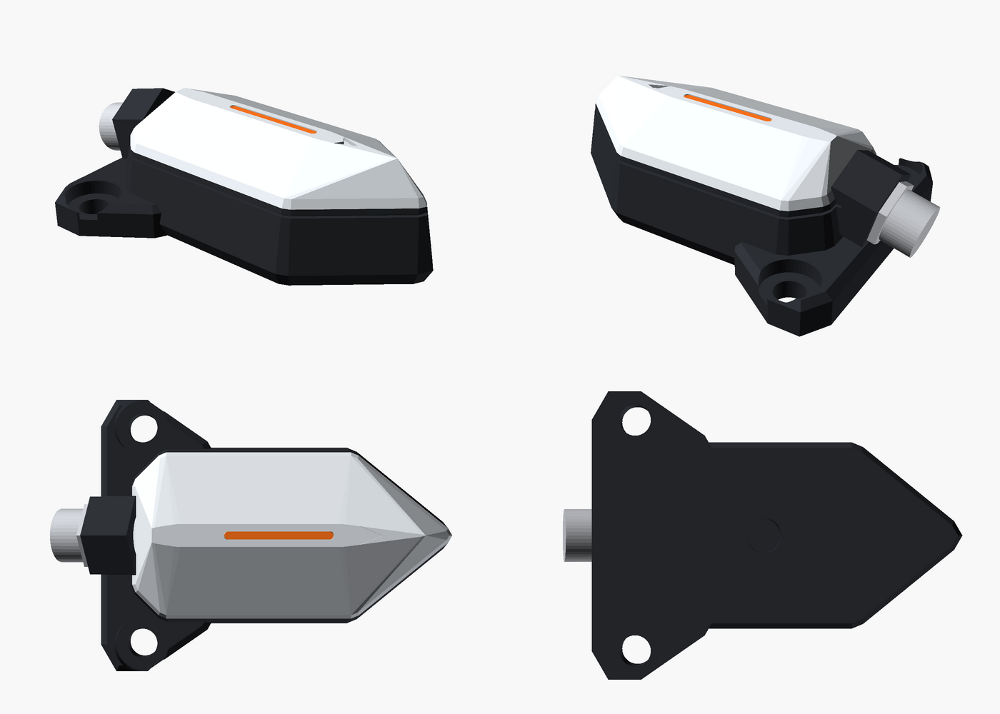
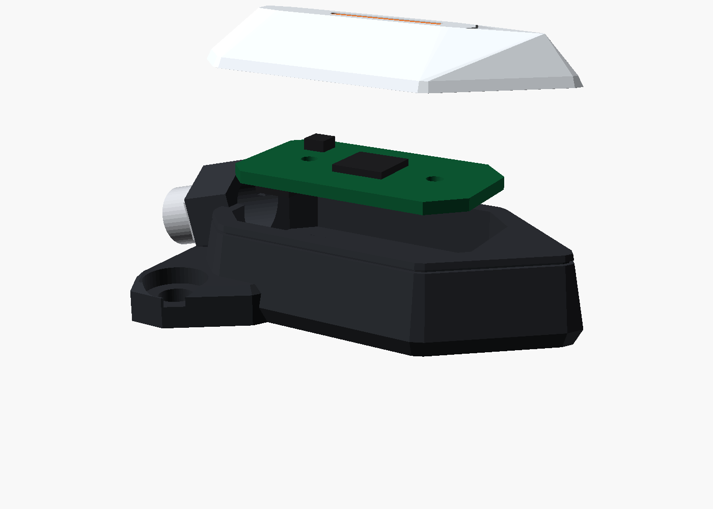

# Enclosure concept "Shard"

The vibration sensor's housing (docs/vibsensor.md, board
[hardware/vibsensor](../README.md)): a parametric OpenSCAD model
(`shard.scad`), its STLs for prototype prints, and renders.

## The idea

A faceted, low "shard" instead of a round can.
- **Easy to mount flat:**
  - two M4 bolts through swept-back lugs at the tail;
  - or an M6 stud in the tapped hole under the accelerometer.
- **Orientation:** the pointed nose is the sensor's +X, also marked by
  an arrow on the ridge. Mounted along a machine axis, the readings need no
  mapping.
- **LED:** a light-pipe slit along the ridge, seen from any side.
- **Cable:** the M8 socket in the tail, tilted up 15°, so the cable clears
  the surface the sensor sits on.

## Build-up

| part | what | how |
|---|---|---|
| base | the floor (5 mm, solid) and the walls, the lugs, the M8 boss | milled from aluminium 6082, black anodised; walls drafted outward toward the foot |
| board | 32 × 18 mm, chamfered to the same shape (gen/board.py) | on two M2 bosses of the floor, 2.2 mm above it (room for the bottom-side parts); the IIS3DWB over the M6 hole |
| potting | fills the cavity to 2.6 mm over the board's top | a hard epoxy: it couples the board to the floor, as the bosses do |
| cover | faceted cap, ridge 5.5 mm over the cavity | aluminium (milled) or glass-filled PA12 (SLS), light grey; glued on the potting's rim |
| light pipe | clear / orange insert in the ridge's slit | over the LED (placed under it in the layout) |
| M8 socket | M8 × 1, 4-pin, rear-mounted in the tail boss | its leads to the board's J1 pads |

**Size** (from the model):
- about 50 mm long including the lugs, 43 mm across the lugs, 17 mm
  high;
- the body without lugs: 46 × 24 mm.

**Why the floor carries the sensor:** the accelerometer sits right over
the mounting point. From it the path to the machine is the board, two
short bosses and the potting into solid aluminium, so the housing doesn't
resonate in the 6.3 kHz band (docs/vibsensor.md §1).

## Files

| file | what |
|---|---|
| `shard.scad` | the model. `part` = assembly, exploded, base, cover, pcb. The parameters at the top follow the board. |
| `stl/shard-base.stl`, `stl/shard-cover.stl` | for prototype prints |
| `render/` | front, rear, top, bottom, exploded; `sheet.png` holds the first four |
| `Makefile` | `make`: STLs and renders (OpenSCAD; xvfb-run without a display) |

## Open before drawings

- **M8 socket:** the exact rear-mount socket, its thread depth and how it
  is sealed.
- **Wall and floor:**
  - wall thickness for milling (2.4 mm now);
  - the floor's thickness against the M6 thread depth (4 mm now).
- **Resonance:** check the housing's first resonance, which should sit well
  above 6.3 kHz. FEA on the model, or a tap test on a print.
- **Potting:** compound and depth; how air escapes during potting.
- **IP67:** the cover's seal to the base, if it isn't fully potted
  under it.
- **LED:** placed under the slit in the board's layout.
