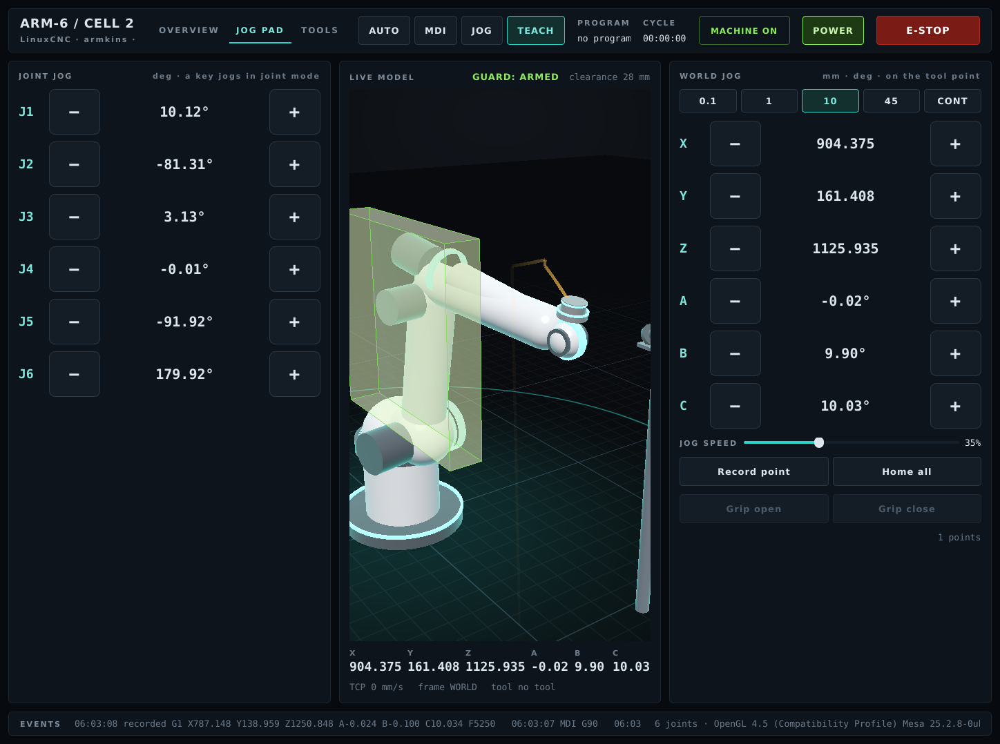
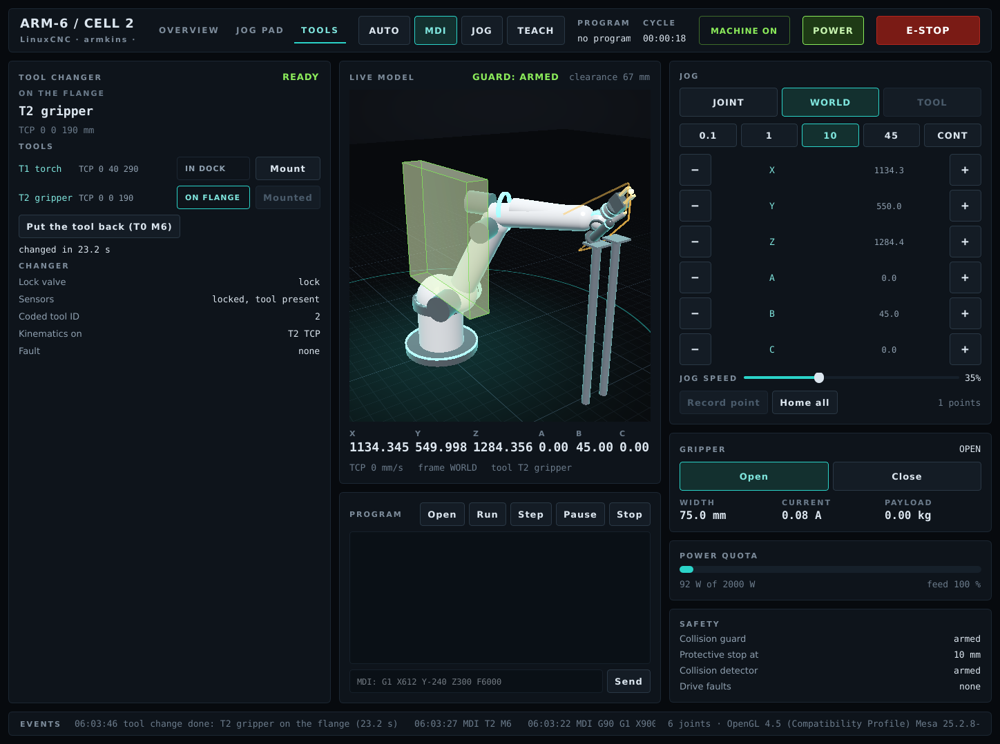

# arm6hmi: the ARM-6 operator screen for LinuxCNC (QtVCP)

The operator screen of `docs/hmi/operator.dc.html` as a working QtVCP
screen. The 3D view is `linuxcnc/vis3d`'s `Vis3dView` (C + shaders, light
Python wrapper), so it runs on a Raspberry Pi 4. Basic operation is all
here; a teach pendant (`docs/hmi/pendant.dc.html`) is meant as an add-on
view later.


| File | What |
|---|---|
| `arm6.ui` | The layout (Qt Designer). Widgets carry a `role` property the stylesheet matches |
| `arm6.qss` | The look: near-black ground, cyan accent, amber warnings, red stops |
| `arm6_handler.py` | Builds the 3D view, the joint, jog-pad and tool rows and the drive table. Wires the buttons to `qtvcp.core.Action` and refreshes everything at 10 Hz |
| `arm6_postgui.hal` | Nets the joints and armguard into the 3D view's pins |
| `arm6_changer_postgui.hal` | With a tool changer: the mounted tool into the 3D view |
| `arm6_selftest.py` | Drives the running screen through its own buttons (`ARM6HMI_TEST`) |

## Views

The header switches between three views around the same 3D view.

**OVERVIEW** (above):

| Panel | Source |
|---|---|
| Header | View tabs, mode buttons (AUTO / MDI / JOG / TEACH), program name, cycle time, state pill, POWER, E-STOP / RESET |
| Joints | `stat.joint[N]`: position bar within the limits, deg, deg/s, following error (amber above half of `max_ferror`) |
| Drives | `<DRIVE_PINS>.current`, `.power` and `.fault` per joint plus the gripper drive |
| Live model | `Vis3dView` posed from `joint.N.pos-fb`. The cell's obstacles, the tools in their docks. Guard colours: green OK, amber NEAR, red STOP |
| Pose | `stat.actual_position` X Y Z A B C (on the tool's TCP), TCP speed, frame, tool |
| Program | Open / Run / Step / Pause / Stop, the G-code with the current line, MDI |
| Jog | JOINT / WORLD frame, increments 0.1 / 1 / 10 / 45 or continuous, speed, Record point (TEACH: appends `G1 ...` to `teach.ngc`), Home all |
| Gripper | `armgrip.0.*`: state, gap, the drive's current, payload; Open / Close by MDI (`M65` / `M64 P0`) |
| Power quota | `powerquota.0.total-power`, `.feed-scale`, `.limiting` |
| Safety | armguard state and limit, `armcollide.0.collision`, drive faults |

**JOG PAD**: big keys for jogging at the machine.
- Joints on the left and X Y Z A B C on the right.
- Each key jogs in its own frame. A joint key puts LinuxCNC in joint mode; an axis key puts it in world mode, which needs the joints homed.
- Also on this view: the increments, the speed, Record point, Home all and the gripper.
- The program panel is hidden, so the 3D view gets the height.



**TOOLS**: the tool changer, shown only when `armtool` is loaded.
- The tool on the flange with its TCP.
- A row per tool from the tool table (`[STMBL_ARM] TOOLS`): IN DOCK or ON FLANGE.
- **Mount** sends `T<n> M6`; **Put the tool back** sends `T0 M6`.
- With `TOOL_READY` set, the screen first moves to that pose, then sends M6.
- While the change runs, the view shows its progress and the lock state.
- At the end it checks that armtool, LinuxCNC (`tool_in_spindle`) and the kinematics (`armkins.tool`) agree.
- The changer panel shows the lock valve, the sensors, the coded tool ID, the TCP the kinematics run on, and a fault with its reason.

The 3D view follows the change live. The tool leaves its dock when it locks onto the flange and goes back when it is released there.



**The guard** follows armguard's own semantics:
- `armguard.0.state` non-zero means stopped (`reason` 1: collision, 2: protective stop).
- Otherwise the screen compares `armguard.0.clearance` (mm) with the cell's `prevent` limit. It shows NEAR below twice the limit, else ARMED.
- The 3D view draws the clearance shell at the limit's radius.

Panels whose component isn't loaded hide themselves (gripper, quota, TOOLS). With a tool changer, the gripper's buttons work only while the gripper is on the flange.

## Use

```ini
[DISPLAY]
DISPLAY = qtvcp arm6            # the screen in <config>/qtvcp/screens/arm6/
[HAL]
POSTGUI_HALFILE = arm6_postgui.hal
POSTGUI_HALFILE = arm6_changer_postgui.hal   # with the tool changer
[ARM6HMI]
VIS3D = /path/to/stmbl/linuxcnc/vis3d   # built: make -C linuxcnc/vis3d
TOOL_READY = G90 G1 X900 Y300 Z1150 A0 B45 C0 F6000   # optional
```

The handler's docstring lists the other `[ARM6HMI]` keys:
- `MODEL`
- `DRIVE_PINS`
- `GRIP_OPEN` / `GRIP_CLOSE` / `GRIP_TOOL`
- `QUOTA_MAX`
- `TEACH_FILE`
- `PREVENT_MM`

The 3D view loads armguard's cell (`[ARMGUARD] CELL`), so it draws the obstacles the guard checks. With a changer it also draws the tool table that the cell includes.

The default model is `models/arm6_changer.vis` with a changer, else `arm6_lcnc.vis`. Both say `joints theta`, because LinuxCNC's genserkins / armkins joint values include the DH theta0.

On a Pi:
- Qt under X11 uses desktop GL through GLX, and vis3d takes its GLSL 1.20 path.
- `VIS3D_GLES=1` asks Qt for GLES 3.0 instead.
- `VIS3D_SAMPLES=4` turns MSAA on (default off: the Pi resolves the FBO every frame).

## Test

```sh
make -C hwtest/arcmate-sim test-hmi    # as a non-root user, needs Xvfb
```

The test copies the arcmate-sim tool changer config (as `test-tool`: armkins, M6 = toolchange.ngc), adds the gripper and power quotas, sets `DISPLAY = qtvcp arm6`, and runs LinuxCNC on Xvfb. The self-test then works the screen through its own buttons:
- E-STOP reset, power on, home all;
- jog J1 +10° (the row, the 3D pin and the tool point follow);
- an MDI move in Z (the pose label follows);
- check the guard is armed with the cell's 10 mm;
- record a point;
- on the JOG PAD: J2 +10° (joint mode), then X −10 mm (world mode);
- on TOOLS: mount T1 (torch), change to T2 (gripper), put it back. After each change it checks armtool, LinuxCNC, the kinematics, the tool rows and the 3D view's tool point;
- E-STOP.

It reports 36 checks as TAP (36/36 here, llvmpipe) and saves a screenshot per view.

Needs PyQt5 (and QScintilla, PyOpenGL) for LinuxCNC's Python. In the cloud image that is Python 3.12; see `DEBUGNOTES.md`.

## Open points

- **TOOL frame jog:** the button is there but disabled; armkins' tool frame jog isn't wired to the screen yet.
- **Not on a Pi yet:** check the frame rate there with `vis3d_render --bench`, and check the screen at the Pi's display size.
- **The pendant** (`docs/hmi/pendant.dc.html`) is to be an add-on view, with a deadman.
- **Dock stands** in the 3D view are generic (a fork plate on a post under each dock pose); the real rack wants its own parts.
