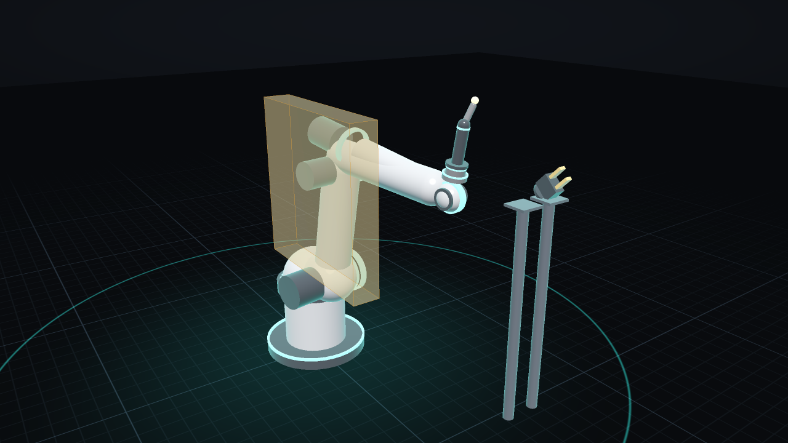

# vis3d: a native 3D view of the arm for LinuxCNC screens

A C library that draws the six-axis arm with shaders, and a light Python
wrapper that puts it into a QtVCP screen. Built for a Raspberry Pi 4
running the GUI next to LinuxCNC: the geometry is uploaded once, and a
frame is one matrix per link and one draw call per part. Python only
passes joint values in and calls `draw`, a handful of calls a frame,
unlike Vismach, which makes thousands of PyOpenGL calls.




## Contents

- [Layout](#layout)
- [The look](#the-look)
- [Model files](#model-files)
- [Using it](#using-it)
- [GL support](#gl-support)
- [Tests](#tests)
- [Open points](#open-points)

## Layout

| File | What |
|---|---|
| `vis3d.h` | the API: load a model, set joints, overlays, camera, `gl_init` / `resize` / `draw` |
| `model.c` | the model file parser, primitive tessellation, STL (binary and ASCII), the DH chain's frames, camera |
| `render.c` | GL: entry points through the host's `getproc`, shader dialect per context, buffers, the frame |
| `shaders.h` | the shaders, written once and mapped to GLSL ES 3.00 / 1.00 and GLSL 3.30 / 1.20 |
| `vmath.h` | 4×4 matrices (column-major), Craig DH |
| `vis3d.py` | ctypes binding (`Vis3d`) |
| `qtvcp/vis3d_widget.py` | `Vis3dView`, a `QOpenGLWidget` for QtVCP: HAL pins in, mouse orbit / pan / zoom |
| `vis3d_render.c` | offscreen renderer (EGL, no X): PNG screenshots and `--bench` frame rates |
| `models/arm6_arm.vis` | the ARM-6 arm without a tool: includes arm_sim's `arcmate_base.arm`, adds the look |
| `models/arm6.vis` | the arm with a gripper and a demo cell (the screenshots, the tests) |
| `models/arm6_lcnc.vis` | as LinuxCNC sees it (`joints theta`), the electric gripper on the flange |
| `models/arm6_changer.vis` | as LinuxCNC sees it, with the tool changer's master plate and the tools' looks (torch, gripper) |

The library links no GL library and never opens a window. The host makes
its context current and passes its `getproc`; Qt's
`QOpenGLContext.getProcAddress` is what the widget passes. Without one it
falls back to EGL's or GLX's.

## The look

- **Ground:** a dark studio. A gradient background with a vignette, and
  fog into it.
- **Floor:** a procedural grid with a fine and a coarse step. The arm's
  reach is drawn as a circle in the accent colour, the work area glows
  faintly, and there's a soft contact shadow at the base.
- **Lighting:** a cool key light, a warm fill from behind, and a sky/ground
  ambient. Blinn specular is set by each material's roughness, with a
  fresnel rim light in the accent colour.
- **Materials:** per part (`color`, `metal`, `rough`, `emissive`, `alpha`,
  `accent`). Emissive parts, such as the joint rings, pulse slightly.
- **Overlays:**
  - Obstacles are drawn translucent with edges. The guard colours the
    nearest one: green ok, amber slowing, red stop.
  - A clearance shell around the tool point shows the guard's radius,
    with a fresnel rim and slow scan lines.
  - The tool point's trail is a ribbon, fading with age.
  - Per-link tints mark a joint in fault or a selection.
- **No per-pixel full-screen passes.** No bloom, blur or shadow maps, so
  the Pi's GPU only pays for the pixels the arm covers.

## Model files

Text, `#` comments, angles in degrees, lengths in the file's unit
(`units m`, the default, or `units mm`):

```
dh J a alpha d theta0          Craig DH as genserkins / arm_sim (J from 1)
prismatic J                    joint J moves d instead of theta
pin J NAME                     the HAL pin with joint J's position
joints offset|theta            joint values are offsets from theta0 (default, arm_sim)
                               or the whole DH theta (LinuxCNC's genserkins)
limits J MIN MAX
tcp X Y Z                      tool point in the last link's frame
material NAME [color R G B] [metal M] [rough R] [emissive E] [alpha A] [accent]
part L box SX SY SZ [at X Y Z] [rpy A B C] [material M]
part L cylinder R H [axis x|y|z] [at ..] [rpy ..] [material M]
part L ring R T H [axis x|y|z] [at ..] [rpy ..] [material M]
part L sphere R [at ..] [material M]
part L capsule X1 Y1 Z1 X2 Y2 Z2 R [material M]
part L mesh FILE.stl [scale S] [at ..] [rpy ..] [material M]
body L capsule|sphere ...      arm_sim's collision bodies (geom.h), drawn as "body"
obstacle NAME box|capsule|sphere ...   world obstacles, as geom.h (planes skipped)
camera YAW PITCH DIST [target X Y Z]
include FILE

tool T [NAME]                  the tool changer's tool table (shared/robot/tool.h, mm):
tcp X Y Z [A B C]              after a tool line: its tool point in the flange frame
dock X Y Z A B C ...           the flange's pose with T in its dock (base frame)
part ... tool T                a part of tool T (on the flange, link n)
body ... tool T                tool T's collision body (drawn if T has no parts)
```

A tool's parts are drawn on the flange while it is mounted
(`vis3d_set_tool`, the widget's `tool` pin), else in its dock with a stand
under it. The tool point moves to the mounted tool's TCP.

**A cell file** (armguard's, arm_sim's) can be added to a loaded model
with `vis3d_load_cell` (the widget's `cell` property). It keeps only the
cell's obstacles and the tool table it includes. The arm's bodies come
from the model, so the screen draws exactly what the guard checks.

`L` is the link a part is fixed to: 0 for the base, J for the link after
joint J. Lines the loader doesn't know are skipped, so an arm_sim model can
be included as is. `arm6.vis` does exactly that: the chain, the joint
limits and the collision capsules are the same ones armkins, the guard and
the simulator use. Real link meshes go in as STL, exported from the
robot's CAD or the STEP files that `tools/step2cell.py` already reads.
Default materials: `body`, `dark`, `metal`, `accent`, `warn`, `obstacle`.

## Using it

**In a QtVCP screen:** add a `Vis3dView`, set `model`, and net its pins
(the prefix is the screen's name; `linuxcnc/arm6hmi` is a whole screen):

```
net j0 joint.0.pos-fb => arm6.vis3d.joint-0                 # ... joint-5
net guard armguard.0.state     => arm6.vis3d.guard-state
net clear armguard.0.clearance => arm6.vis3d.clearance      # mm
net tool-mounted => arm6.vis3d.tool                         # armtool.0.mounted
```

Set `guard_limit_mm` to the cell's `prevent` limit. The widget shows:
- STOP while armguard's state is non-zero;
- slowing below twice the limit;
- OK otherwise, with the clearance shell at the limit's radius.

`guard-nearest` (an obstacle's index in the model) is optional: armguard
has no pin for it yet. With LinuxCNC's joint values use a model with
`joints theta` (`models/arm6_lcnc.vis`).

The surface format comes from the environment:
- `VIS3D_GLES=1` asks for GLES 3.0 (the Pi's native API);
- `VIS3D_SAMPLES=N` turns on MSAA (default off; on the Pi it costs a resolve
  every frame).

Mouse: left drag orbits, right or middle drag pans, the wheel zooms, and a
double click clears the trail. `python3 qtvcp/vis3d_widget.py` opens it on
its own with the arm waving (PyQt5, no LinuxCNC).

**From Python** (any GL host):

```python
from vis3d import Vis3d
v = Vis3d("models/arm6.vis")
v.gl_init()                       # in the host's GL context
v.resize(1280, 720)
v.set_joints([0, 20, -10, 0, -70, 0])
v.set_guard(2, 0.15, 0)           # slowing, 0.15 m, the conveyor nearest
v.load_cell("cell_changer.txt")   # obstacles and the tool table (before or after gl_init)
v.set_tool(2)                     # the gripper on the flange, the torch in its dock
v.draw(t)
p, R = v.frame(-1)                # the tool point, for a DRO
x, y = v.project(p)               # where to put a Qt label next to it
```

**Measuring a board:**

```
./vis3d_render models/arm6.vis --api gles3 -s 1280x720 --bench 300
```

prints the frame rate without any window system. Run it on the Pi before
building a screen around it.

## GL support

| Context | Shaders | Where |
|---|---|---|
| OpenGL ES 3.x | GLSL ES 3.00 | Raspberry Pi 4 (ES 3.1, V3D), EGL / Wayland |
| OpenGL ES 2.0 | GLSL ES 1.00 | older boards |
| OpenGL 3.3+ (core or compatibility) | GLSL 3.30 | PCs; Qt on X11 got a 4.5 compatibility context here |
| OpenGL 2.1 / 3.0–3.2 | GLSL 1.20 | the Pi's desktop GL through Mesa (GLX, 2.1 or 3.1): Qt on the Pi's X11 desktop |

Core profiles get one vertex array object, created and kept bound. The
shaders use no derivatives and no textures, so ES 2.0 needs no extensions.

## Tests

```
make check       # 41 loader / kinematics / tool checks, 15 drawing checks
make qt-check    # the widget in PyQt5 on Xvfb (PYTHON=python3.13 here)
make shots       # the screenshots above
```

- **The kinematics:** `tests/test_vis3d.c` compares every link frame with
  `shared/robot`'s `rb_fk` over 200 random poses, within 0.2 µm.
- **The loader:** units, every shape, STL (including a binary file whose
  header starts with `solid`), and error messages with file and line.
- **Drawing:** `tests/render_tests.py` draws offscreen in GLES 3, GLES 2,
  GL 3.3 core, GL 3.1 and GL 2.1. It checks the five images agree, the accent
  shows, a protective stop turns things red, a move leaves a trail, and a
  tool change moves the tool from its dock to the flange.
- **The tool changer:** `arm6_changer.vis` with arcmate-sim's
  `cell_changer.txt`: the tool table, the fixture, the tool point on the
  torch tip, which parts are on the flange, in a dock or hidden.
- **Where it ran:** on Mesa's software renderer (llvmpipe), about 60–70 fps
  at 720p on this machine's CPU. That says nothing about a Pi's GPU; use
  `--bench` there.

## Open points

- **Not run on a Raspberry Pi yet:** the GLES 3.1 path is the one the Pi
  takes, but it has only been exercised on Mesa's llvmpipe here.
- **No Designer entry yet:** the widget follows QtVCP's
  `_HalWidgetBase` pattern and runs inside LinuxCNC in `linuxcnc/arm6hmi`
  (created by the handler). It still needs a Designer plugin entry
  (`qtvcp/plugins/`) to show in the widget box.
- **Placeholder geometry:** the parts in `arm6.vis` are primitives around
  arm_sim's guessed capsules. The real arm wants STL meshes.
- **No text in GL:** labels belong to Qt widgets placed with `project()`.
- **The nearest obstacle:** armguard doesn't export which obstacle is
  nearest, so the widget can't colour it yet. A pin for it would be a
  small addition to armguard.
